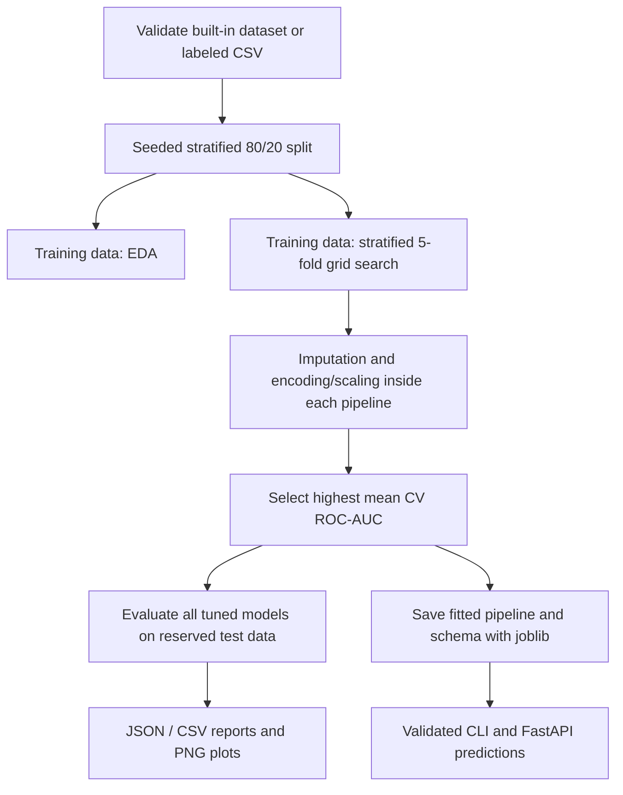
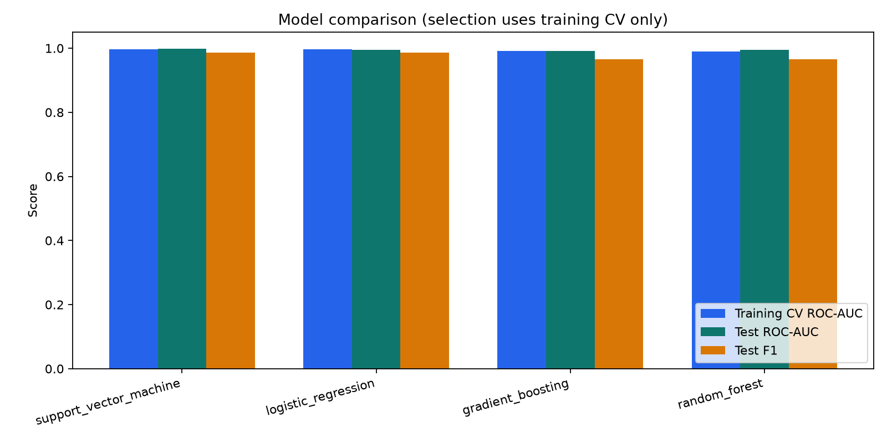
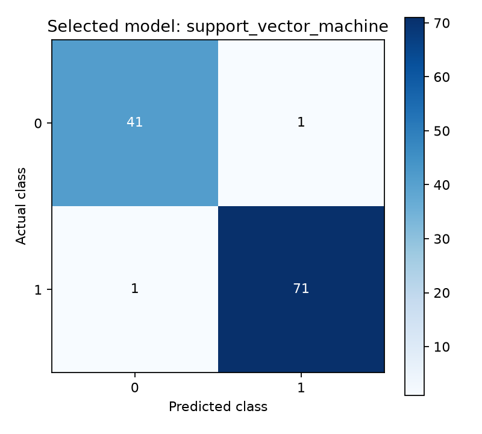

# ML Model Training and Evaluation Pipeline

[](https://github.com/Stasichek7/ml-model-training-pipeline/actions/workflows/tests.yml)


A Python ML engineering portfolio project covering the path from validated data to a saved model and an inference API. It compares Logistic Regression, Random Forest, Gradient Boosting, and Support Vector Machine using reproducible pipelines and training-only hyperparameter search.

The default task uses scikit-learn's bundled Wisconsin Diagnostic Breast Cancer dataset: 569 observations, 30 numeric features, and two classes. No dataset download or paid API is required. Class `0` is malignant; class `1` is benign. This is an educational benchmark, unsuitable for clinical decisions.

## Architecture



Application code is Python only. The stack uses scikit-learn, pandas, NumPy, matplotlib, joblib, FastAPI, Uvicorn, Pydantic, pytest, Ruff, and GitHub Actions. It runs on Windows without Docker; CI also exercises Linux.

```text
src/ml_pipeline/
  data.py             Dataset loading and validation
  preprocessing.py    Numeric and categorical transformations
  training.py         CV search, selection, and persistence
  evaluation.py       Binary metrics and ROC curves
  reporting.py        Training EDA, tables, and plots
  prediction.py       Artifact loading and feature validation
  api.py              Cached inference service
  cli.py              Training, evaluation, reports, prediction, serving
tests/               Unit and integration tests
models/              Generated best model, metadata, and holdout CSV
reports/             Generated run reports plus a measured example snapshot
examples/            Valid prediction payload
.github/workflows/   Windows and Linux CI
.vscode/             Run and Debug configurations
```

## Install on Windows 11

Install Python 3.11 or later and Git, then open PowerShell:

```powershell
git clone https://github.com/Stasichek7/ml-model-training-pipeline.git
Set-Location ml-model-training-pipeline
py -3.12 -m venv .venv
.\.venv\Scripts\python.exe -m pip install --upgrade pip
.\.venv\Scripts\python.exe -m pip install -e ".[dev]"
```

All commands use the virtual environment interpreter directly, so PowerShell activation policy does not need to change. Python 3.11 is also supported: replace `py -3.12` with `py -3.11`. The supplied local workspace already has a project-specific Python 3.12 virtual environment.

For the exact dependency versions used in the recorded run, install `requirements-lock.txt` before the editable project. That snapshot records a Windows/Python 3.12 environment; the compatible ranges in `pyproject.toml` are used for the cross-platform CI matrix.

## Train and inspect results

Run these commands from the repository root:

```powershell
.\.venv\Scripts\python.exe -m ml_pipeline.cli train
.\.venv\Scripts\python.exe -m ml_pipeline.cli evaluate
.\.venv\Scripts\python.exe -m ml_pipeline.cli report
```

The first command tunes all four models and writes `models/best_model.joblib`, `models/metadata.json`, and `models/holdout.csv`. The second evaluates the saved winner against that run's holdout CSV, checking its SHA-256 digest, and writes `reports/reevaluation.json`. The third regenerates tables and plots from `reports/evaluation.json` without training again.

Configuration is explicit and repeatable:

```powershell
.\.venv\Scripts\python.exe -m ml_pipeline.cli train --seed 42 --cv-folds 5 --test-size 0.2 --n-jobs 1
```

The default uses one worker to keep CPU and memory use predictable. `--n-jobs -1` enables parallel grid search. An isolated output directory is useful for retaining separate experiments:

```powershell
.\.venv\Scripts\python.exe -m ml_pipeline.cli train --output-dir runs\experiment1
```

Subsequent commands can select its paths with `--model`, `--data`, or `--reports-dir`; consult `--help` for each command.

An optional labeled CSV is supported:

```powershell
.\.venv\Scripts\python.exe -m ml_pipeline.cli train --data data\classification.csv --target target
```

CSV labels must contain exactly `0` and `1`, with enough observations per class for splitting and CV. Features may be numeric, string categories, or boolean categories. Missing feature values are allowed. Missing targets, infinite numeric values, invalid schemas, and mixed categorical types are rejected. Custom CSV classes are named `0` and `1` in predictions.

## Evaluation methodology

- A fixed seed of `42` creates a stratified split: 455 training and 114 test observations for the default dataset.
- Five shuffled stratified training folds are shared across candidate searches.
- Numeric features receive median imputation and standard scaling; categorical features receive most-frequent imputation and one-hot encoding with unknown categories ignored. All preprocessing is fitted inside each CV pipeline. EDA uses training data only.
- Search spaces cover 3 Logistic Regression candidates, 4 Random Forest candidates, 4 Gradient Boosting candidates, and 6 SVM candidates: 85 CV fits plus four final training refits with the default five folds.
- The winner is selected by **highest mean training CV ROC-AUC**, with declaration order breaking exact ties. Test metrics never determine the winner.
- Every tuned model is then evaluated on the same reserved test split. Reports include accuracy, precision, recall, F1, ROC-AUC, confusion matrices, per-class classification reports, winning parameters, fold scores, and CV standard deviation.
- Precision, recall, F1, and ROC-AUC use **class 1 (benign)** as the positive class. Inspect the per-class report to assess class 0. ROC-AUC uses decision scores when available, otherwise positive-class probabilities. SVM probability calibration can produce a different ranking from its decision scores.
- CV search scores are optimistic tuning estimates. The single holdout is the final benchmark; inspecting comparison results must not become repeated test-driven tuning.

The approach follows scikit-learn's guidance on [preventing data leakage with pipelines](https://scikit-learn.org/stable/common_pitfalls.html) and [cross-validation](https://scikit-learn.org/stable/modules/cross_validation.html).

Generated reports include `eda_summary.json`, `missing_values.csv`, feature and class plots, `cv_<model>.csv` search results, `evaluation.json`, `model_comparison.csv`, comparison/confusion/ROC plots, and optional reevaluation/prediction JSON. Large generated artifacts and local environments are excluded from Git. The curated example snapshot is versioned separately.

## Measured example

Executed locally on Windows with Python 3.12.13 on November 15, 2026, using the default five-fold configuration. These are measured values, rounded to four decimal places.

| Model | CV ROC-AUC mean +/- std | Test accuracy | Test precision | Test recall | Test F1 | Test ROC-AUC |
|---|---:|---:|---:|---:|---:|---:|
| SVM (selected) | 0.9964 +/- 0.0049 | 0.9825 | 0.9861 | 0.9861 | 0.9861 | 0.9977 |
| Logistic Regression | 0.9959 +/- 0.0050 | 0.9825 | 0.9861 | 0.9861 | 0.9861 | 0.9954 |
| Gradient Boosting | 0.9918 +/- 0.0053 | 0.9561 | 0.9467 | 0.9861 | 0.9660 | 0.9907 |
| Random Forest | 0.9906 +/- 0.0058 | 0.9561 | 0.9589 | 0.9722 | 0.9655 | 0.9944 |

The selected SVM uses `C=10.0`, `gamma=0.01` and has confusion matrix `[[41, 1], [1, 71]]` (rows = true classes, columns = predicted classes, order 0/1). It classified 112 of 114 holdout samples correctly. Selection was finalized from training CV before test metrics were calculated.





The versioned [example results](reports/example_results.json) contain exact metrics, fold scores, parameters, configuration, and dependency versions. Model binaries and full run artifacts are regenerated locally by training. Verification completed with **63 passing tests**, Ruff lint/format checks, CLI evaluation/report/prediction checks, and a live Uvicorn HTTP smoke check of all three endpoints (including invalid-input handling). Dependency deprecation warnings are described below.

## Batch prediction

A valid sample containing all 30 features is included. JSON records must contain exactly the trained feature names. Feature order does not matter; `null` represents a missing value. Numeric strings, booleans in numeric fields, unknown/missing keys, nonfinite numbers, and batches outside 1-1000 records are rejected.

```powershell
.\.venv\Scripts\python.exe -m ml_pipeline.cli sample
.\.venv\Scripts\python.exe -m ml_pipeline.cli predict --input examples\sample_input.json --output reports\predictions.json
```

A feature-only CSV is accepted with `--input new_data.csv`; omit the target column. The returned JSON includes the selected model name, ordered class IDs, predicted class ID/name, and probabilities aligned with those class IDs.

## FastAPI inference

Train once, then start the server:

```powershell
.\.venv\Scripts\python.exe -m ml_pipeline.cli serve --host 127.0.0.1 --port 8000
```

Interactive API documentation is at <http://127.0.0.1:8000/docs>. From a second PowerShell terminal:

```powershell
Invoke-RestMethod -Uri http://127.0.0.1:8000/health
Invoke-RestMethod -Uri http://127.0.0.1:8000/model/info
$payload = Get-Content -LiteralPath examples\sample_input.json -Raw
Invoke-RestMethod -Uri http://127.0.0.1:8000/predict -Method Post -ContentType 'application/json' -Body $payload
```

`GET /health` returns HTTP 200 with liveness and `model_loaded` readiness. `GET /model/info` returns schema, labels, CV selection details, split provenance, and package versions. `POST /predict` validates the body with Pydantic and the saved feature schema; invalid inputs return HTTP 422. A missing model leaves the service live and returns HTTP 503 for model-dependent routes. An invalid existing artifact fails startup. The pipeline loads once per worker at startup and is reused for requests; training is never part of inference. Restart the server to load a newly trained model.

Direct Uvicorn use and environment configuration are also supported:

```powershell
$env:ML_MODEL_PATH = 'models/best_model.joblib'
.\.venv\Scripts\python.exe -m uvicorn ml_pipeline.api:app --host 127.0.0.1 --port 8000
```

`.env.example` documents the environment variable; it is a reference file and is not automatically loaded. Load only trusted joblib artifacts: pickle-based formats can execute code.

## VS Code and quality checks

Open this repository folder in VS Code, install the Python and Python Debugger extensions, and use **Run and Debug** (F5):

- **Train ML Models**
- **Run ML Evaluation** (after training)
- **Start FastAPI Server** (after training)
- **Run Tests**

The checked-in configurations use `.venv/Scripts/python.exe` and the workspace as the working directory.

```powershell
.\.venv\Scripts\python.exe -m pytest -v
.\.venv\Scripts\python.exe -m ruff check .
.\.venv\Scripts\python.exe -m ruff format --check .
```

Tests cover dataset validation, missing/categorical preprocessing, unseen categories, training/test isolation, CV selection, evaluation metrics, serialization, CLI workflows, prediction schemas, API availability/errors, and model-load caching. Integration tests train all four real estimators with smaller grids. CI runs lint, formatting, tests, and a three-fold end-to-end training smoke run on Windows and Ubuntu.

## Limitations and future work

This is a local, production-style portfolio implementation, without authentication, rate limiting, monitoring, a model registry, or a deployment service. The default dataset is small, numeric, and has no missing values; synthetic tests exercise categorical/missing-value paths. Reported metrics use a single split, not external validation, and are not evidence of clinical reliability. Standard random splits are unsuitable for grouped or temporal data. Probabilities are not independently calibrated or audited for fairness. Versions are recorded, but cross-platform numeric libraries can produce small differences; serialized models should use the matching dependency environment.

The recorded environment emits dependency deprecation warnings for SVC's built-in probability estimation, pandas' CSV precision argument, and the HTTPX-backed Starlette test client. The scikit-learn range is bounded below 1.11 while that SVC interface is in use. Migrating to explicit probability calibration and the next test-client interface is future maintenance work. These warnings do not indicate test failures.

Future improvements include nested CV or repeated holdouts, external datasets, probability calibration and threshold selection, drift monitoring, authenticated deployment, and experiment/model registry integration.

## Data and license

The dataset is provided by scikit-learn's [load_breast_cancer](https://scikit-learn.org/stable/modules/generated/sklearn.datasets.load_breast_cancer.html), originating from the UCI Wisconsin Diagnostic Breast Cancer dataset. Dataset usage terms remain those of its source. Project code is licensed under [MIT](LICENSE).
